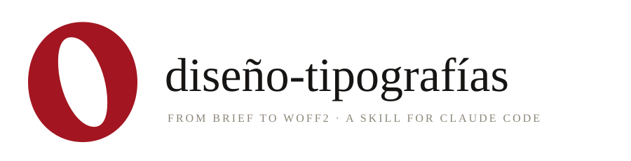
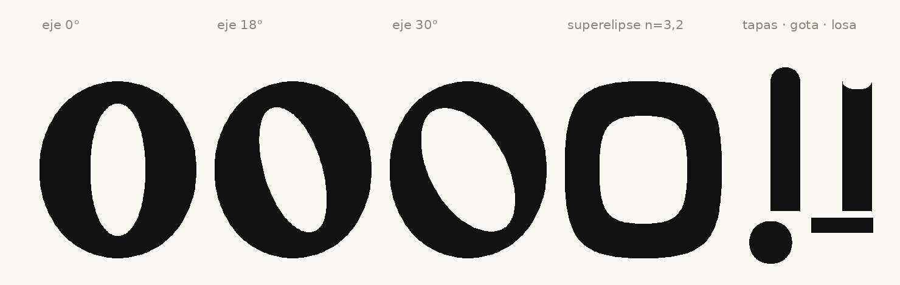
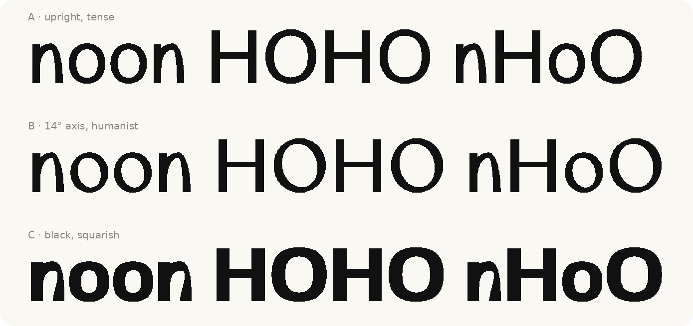
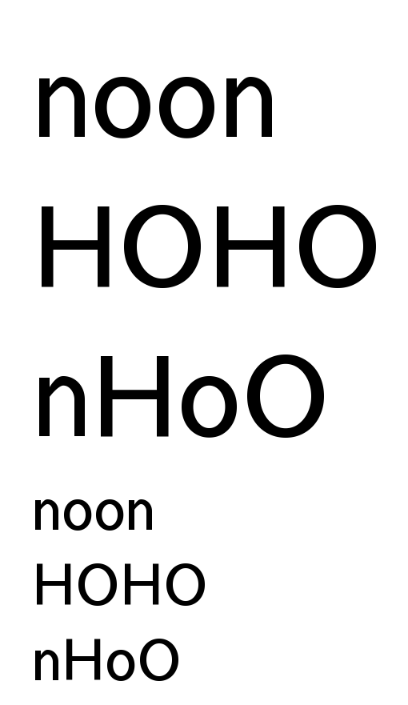
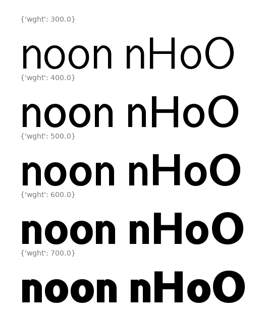

<div align="center">



<br><br>

<strong>An <a href="https://agentskills.io">Agent Skill</a> that designs and produces original typefaces end to end:<br>from the brief to the WOFF2, with checks at every phase and per-glyph provenance records.</strong>

<br><br>


<br><br>

<picture>
  <source media="(prefers-color-scheme: dark)" srcset="docs/especimen-dark.png">
  
</picture>

<em>Drawn by the skill's own stroke engine: inclined contrast axis, Lamé superellipse and terminals<br>(curved caps, teardrop, slab). Masters come out interpolation-compatible by construction.</em>

</div>

<br>

---

It follows the open [Agent Skills](https://agentskills.io/specification) format, so it works with any compatible agent that can run shell commands and look at PNG images (Claude Code, OpenAI Codex, Gemini CLI, Cursor, GitHub Copilot and others). It works with UFO + designspace sources and compiles with fontmake. It can draw by code, or act as the engineering and QA partner of a person drawing in Fontra, FontLab or Glyphs. The skill's instructions and reference library are written in Spanish; use it in any language — the agent reads them natively.

## ✍️ What you can ask for

```text
I want a geometric display typeface, variable in weight, ready for my website.
Review the spacing and metrics of the font in this folder.
My font shows faux bold in Word and accents are misplaced. Fix it.
Prepare this font for the web without losing OpenType features.
Which app should I use to design type on Windows?
```

The skill triggers on requests like these. It is not for picking existing fonts or laying out with them, and it will not clone or rename someone else's font: it proposes legitimate alternatives instead.

## ✏️ Sketch mode

Before any project exists, the skill can explore a concept as **parametric sketch sheets**: variants rendered straight to PNG — no UFO, no designspace, no compilation — in under a second. A sketch file declares `VARIANTES` (name → parameters) and `glifos(ufo, p)` drawn with the stroke engine, so the approved sketch's glyph code and parameters transfer **as-is** into the real build. Nothing is thrown away.

<div align="center">

<picture>
  <source media="(prefers-color-scheme: dark)" srcset="docs/sketch-dark.png">
  
</picture>

<em>One sheet, three deliberately distant directions. Sketches judge shape and color —<br>not spacing — and are never published: the gate to a real font is still the full build.</em>

</div>

## 🧭 How it works

Every phase ends at a **gate**: no moving on until it passes.

| Phase | Work | Gate |
|---|---|---|
| **0 · Concept** | Brief, uses, languages, parameter hypotheses | Written reason to exist and first provenance seal |
| **1 · Proof of concept** | n, o, H, O; then a, d, e, h, s | The idea reads in words and the person approves it |
| **2 · First draft** | Lowercase, caps, figures, punctuation | Even color in running text |
| **3 · Family** | Weights, widths, italic, small caps | Compatible masters, no jumps or kinks |
| **4 · Coverage** | Diacritics, glyph set, languages | Real text correct in the brief's languages |
| **5 · Engineering** | Kerning, features, metrics, naming, hinting | One-command build and shaping tests |
| **6 · Quality** | Automated QA plus review in real environments | Signed-off human review |
| **7 · Release** | WOFF2, CSS, license, final audit | No lost characters or features, full provenance |

This workflow is a synthesis of this skill's research, not a published standard.

**Looking is mandatory.** After every change, `proof.py` renders PNG proofs to be judged by eye; `build.py` compiles and runs the automated gates (OTS, consistency, HarfBuzz shaping, QA):

<div align="center">

<picture>
  <source media="(prefers-color-scheme: dark)" srcset="docs/pruebas-palabras-dark.png">
  
</picture>&nbsp;&nbsp;<picture>
  <source media="(prefers-color-scheme: dark)" srcset="docs/pruebas-pesos-dark.png">
  
</picture>

<em>Real <code>proof.py</code> output for the example generator's variable font.</em>

</div>

## 📦 Installation

Clone the repository into your agent's skills folder **as `diseno-tipografias`**: the Agent Skills format requires the folder name to match the skill's `name`.

```bash
# Claude Code (personal skills)
git clone https://github.com/Pizarradas/syx--typography.git ~/.claude/skills/diseno-tipografias

# Agents that read the shared project convention
git clone https://github.com/Pizarradas/syx--typography.git .agents/skills/diseno-tipografias
```

For any other agent, use the skills folder its documentation gives. The agent picks the skill up from its description when a request matches; agents with explicit invocation can also call it by name. To update, run `git pull` in that folder.

## ⚙️ Requirements

- Linux, macOS, or Windows with WSL2. The toolchain has only been tested on Linux under WSL2.
- [uv](https://docs.astral.sh/uv/getting-started/installation/) and git.

On first use the skill runs `scripts/setup_env.sh`, which creates an isolated environment at `~/.local/share/type-design/venv` with fontTools, fontmake, gftools and other PyPI tools; `setup_env.sh --qa` adds the audit tools (Font Bakery, diffenator2). Nothing is installed system-wide. Change the location with the `TYPE_DESIGN_VENV` variable.

On Windows, keep font projects inside the WSL filesystem, not under `/mnt/c`: a UFO is hundreds of small files, and I/O against the Windows drive is several times slower.

`fontspector` is optional: when installed, QA uses it instead of Font Bakery.

## 🖥️ Recommended apps

| Situation | App |
|---|---|
| By code, with an agent | UFO + designspace and fontmake |
| Windows, free | Fontra Pak |
| Windows, professional | FontLab 9 |
| macOS, professional | Glyphs 4 |

Details and their limits live in [`references/04-programas-y-toolchain.md`](references/04-programas-y-toolchain.md).

## 🧰 What's inside

<details>
<summary><strong>Tools</strong> (<code>scripts/</code>) — 16</summary>

<br>

| Script | Purpose |
|---|---|
| `setup_env.sh` | Installs the toolchain in an isolated environment; `--qa` adds the audit tools |
| `sketch.py` | Sketch sheets: parametric variants to PNG with no project and no compilation |
| `new_project.py` | Creates the UFO, designspace, brief and provenance log |
| `trazos.py`, `motor.py` | Drawing by code: per-project tension and cut angle, inclined contrast axis, superellipse, caps, teardrop and slab; masters compatible by construction |
| `check_sources.py` | Compatibility, contours, nodes at extremes, kinks, inflections, anchors and style links |
| `verificar.py` | Mathematical audit with explicit tolerances: topology, exact zones, kinks, handles, G2 and the brief's rules (`verificar.json`); `--meta` tests itself |
| `reglas.py` | Construction rules: translation-contrast thickness, nodes placed with the real stroke width, advance from the ink, handles realigned on the grid, G2 harmonization |
| `cincel.py` | Chisel terminals with one rule for straight and curved strokes: exact trim and angle solved against the real edges |
| `build.py` | Compiles and verifies with OTS, consistency, shaping and QA; usWin never below the line metrics, so an unfinished font does not clip fallback text on Windows |
| `proof.py` | PNG proofs: control strings, words, text, waterfall, glyph grid, weights, languages, dark |
| `shape_tests.py` | HarfBuzz shaping tests, also against a WOFF2 |
| `coverage.py` | Per-language coverage of letters, marks and punctuation |
| `web_export.py` | WOFF2 and CSS, verifying no characters or features get lost |
| `registro.py` | Per-glyph provenance and hashed seals |
| `copy_check.py` | Tracing alarm between two fonts |

</details>

<details>
<summary><strong>Reference library</strong> (<code>references/</code>) — 9</summary>

<br>

| File | Topic |
|---|---|
| `01-brief-y-parametros.md` | Brief, vocabulary, parameters and legibility evidence |
| `02-dibujo-y-correcciones.md` | Optical corrections, Béziers, weights, italics and figures |
| `03-espaciado-y-kerning.md` | Spacing and kerning |
| `04-programas-y-toolchain.md` | Apps, toolchain and known traps |
| `05-ingenieria-opentype.md` | Metrics, naming, features, variable fonts, hinting and QA |
| `06-idiomas-y-cobertura.md` | Glyph sets, Spanish, diacritics and other scripts |
| `07-web.md` | Web export, loading and performance |
| `08-originalidad-licencias-ia.md` | Originality, law by territory, licensing and AI |
| `09-generos.md` | Constraints by typeface genre |

</details>

Templates and examples live in `assets/`.

## 🔍 What to expect

- **Reliable where verifiable:** master compatibility, metrics, naming, features, coverage and builds.
- **By code** it performs best on geometric, modular, monospaced and pixel designs. An expressive text serif needs a person drawing.
- **It does not replace the eye:** passing every check proves conformance, not design quality. Proofs must be reviewed, and the font tested in browsers, Windows, macOS, Word and print.
- **It does not certify originality:** no tool can. The skill provides a method and documents the process.
- **Authorship with AI:** legal protection of AI-generated outlines is uncertain and varies by country. The skill records them per glyph so they can be declared honestly.
- **Dated facts:** prices, versions and browser support reflect November 2026 and will go stale. Re-check before relying on them.
- **Uneven knowledge base:** several canonical books are cited through secondary sources, and many figures are trade conventions. The references label the origin of each claim and the disagreements between sources.

The legal content is orientation only, not legal advice.

## ⚖️ License

[MIT](LICENSE). The license covers the skill, not the typefaces you create with it: their license is yours to decide.

<br>

<div align="center">

<sub>The banner mark, the specimen and the sketch sheet are all drawn by <code>scripts/motor.py</code> and <code>scripts/sketch.py</code> — this skill's own tools.</sub>

</div>
